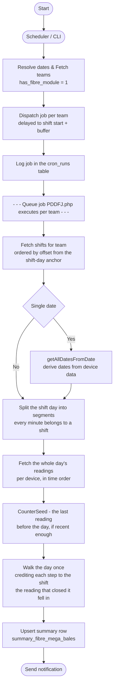

# How the daily summary of Fibre Bales is calculated?

## Step 1: Device Data Collection

- Each fibre bale-producing machine (device) records its production using a counter.
- Data is sent every 20 seconds, and each time a bale is made, the counter increases.

## Step 2: Storage in MySQL database
- All device readings are stored in the `device_data_fibre_bales` and `device_data_fibre_mega_bales_weight`table.
- Each record includes:
    - `device_id` → Which machine produced the bale
    - `bale_date` → Date of production
    - `bale_datetime` → Exact timestamp of production
    - `bales_counter` → Current reading of the machine counter
    - `eb_units` → Energy units used
    - `eb_price` → Cost of electricity consumed
    - `shift_id` → Shift during which bale was produced
    - `shift_name` → Name of the shift
    - `shift_date` → Date of the shift
    - `is_duplicate` → Marks if this reading is repeated
    - `created_at / updated_at` → Record timestamps
- The table may have a unique constraint on (`device_id`, `bale_date`, `bales_counter`) to prevent duplicate counts for the same bale on the same day.
- This ensures that repeated readings (from glitches or retries) are not counted twice.

## Step 3: Running the Scheduler



- Jobs for fibre:
    1. **Fibre Mega Bales (120kg):**
        - Command: `php artisan devicedata:fibre`
        - Runs daily at 00:10 AM
        - Populates the `summary_fibre_mega_bales` table

## Step 4: Data Processing

### 4.1: Remove Old Duplicates
Any records previously marked as duplicates are deleted to start fresh.

### 4.2: Mark New Duplicates
If two consecutive readings from the same device have the same counter value, the later one is marked as duplicate. This prevents double counting.

### 4.3: Identify Dates to Process
The job checks the `bale_date` of records and determines which dates have production data. If no date is given, yesterday is used by default.

### 4.4: Calculate Total Bales for Each Date

Production is **how far the counter travelled**, never how many rows arrived — a lost upload
costs a row but never a bale. The whole shift day is walked once, per device, in time order,
and each step of the counter is added up. The rules for what one step is worth live in
`App\Support\Pulse\ProductionCounter` and are the same for every module:

| The reading | Worth | Why |
|---|---|---|
| the first one the walk has | 1 | the bale that made the counter move |
| higher than the highest so far | the difference | the bales made since |
| at or below the highest so far | 0 | it arrived out of order and was already counted |
| at most half the highest so far | 1 | the machine's counter restarted |

The third row matters more than it looks. Uploads do not always reach us in the order the
bales were made, so the counter can appear to step back by a few. Reading that as a restart —
as this once did — charges a bale for the straggler and then charges the whole drop again
when the counter catches up. One real day of 338 readings was inflated to 578 bales that way.
A genuine restart is nothing like it: it goes to zero.

### 4.5: Shift-wise Aggregation (for Mega Bales)

The shift figures are **buckets of that one day-long walk**, which is why they always add up
to the day. Each step is credited to the shift that the reading which *closed* it fell in.

Two consequences worth stating, because both were once bugs:

- **The counter does not stop at a changeover.** Everything made between one shift's last
  reading and the next shift's first belongs to the later shift. Measuring each shift as the
  span of its own readings credited it a single bale for all of it.
- **Nor does it stop at the day boundary.** The walk is seeded from the last reading before
  the shift day started (`App\Support\Pulse\CounterSeed`), so a machine that ran overnight
  while its uploads failed keeps those bales.

The seed is **bounded to the immediately preceding shift day**. A longer silence is a device
outage: the counter may have travelled across several days, and crediting all of it to the
day the readings came back overstates that day as badly as losing it understates the days in
between. Those are left uncarried and logged as a warning naming the device, the counter
movement and the length of the silence, for a human to settle.

A reading that falls in a stretch of the day no shift covers joins whichever shift it sits
closer to, the uncovered stretch being split at its midpoint.

### 4.6: One measurement, several renderings

The nightly job, the raw fallback the live day is drawn from
(`App\Services\Pulse\FibreShiftDayTotals`), the hourly bars on the dashboard and the mobile
API, and the backfill command are all renderings of the **same walk with the same seed**. A
change to one of them is a change to all of them, or two screens start printing different
numbers for the same day — which is the thing that keeps going wrong here.

### 4.7: Correcting days already closed

`php artisan devicedata:backfill-carryover --dry-run` re-runs the current processing over past
shift dates and prints what would move, writing nothing. Drop `--dry-run` to apply it. Scope it
with `--team_ids`, `--modules` (`fibre`, `growbags`, `modbales`, `modblocks`) and
`--start` / `--end` / `--dates`.

Note what a re-run cannot know: it splits a day under the shift schedule in force **now**, not
the one in force on the day. Where a team's shifts have been edited since, the day's total is
corrected but how it divides between shifts is retrospective — the command warns when it sees
this.

## Step 5: Store Daily Summary
- After calculating totals, the jobs update or insert records in the summary tables:
    - `summary_fibre_mega_bales` (shift-wise, for 120kg bales)
- If a record already exists for the day/shift, it is updated. Otherwise, a new record is created.

## Step 6: Result
At the end of the process, the summary tables have one record per shift for mega bales per team/device, showing the total number of bales produced, weighed, and related metrics. This summary is later used for reports, notifications, and dashboard display.

---

## Table Schemas

### `device_data_fibre_bales`

| Field          | Type     | Description                  |
|----------------|----------|------------------------------|
| id             | bigint   | Primary key                  |
| device_id      | int      | Reference to `devices` table |
| shift_id       | bigint   | Associated shift             |
| bale_date      | date     | Date of bale production      |
| bale_datetime  | datetime | Exact time of production     |
| bales_counter  | int      | Number of bales produced     |
| eb_units       | decimal  | Electricity units consumed   |
| is_duplicate   | boolean  | Flag for duplicate entries   |
| created_at     | datetime | Record creation timestamp    |
| updated_at     | datetime | Record update timestamp      |

**Collection Interval:** Every 20 seconds.

!!! note "Shared with the pith module's bales submodule"
    This table is also written to by `ProcessDeviceDataForModBalesJob` (the pith module's `bales` submodule — see `docs/IoT-Data-Handling.md`), which independently stamps `shift_id` on rows in its own shift windows. This looks like dual ownership of the same column, but `has_fibre_module` and `has_pith_module_bales` are mutually exclusive per team (a team is either "fibre" or "pith", never both), so in practice the two jobs never process the same team's rows. The table name is shared across both product tiers' bale-counting devices, not exclusive to the fibre module.

### `device_data_fibre_mega_bales_weight`

| Field                | Type     | Description                  |
|----------------------|----------|------------------------------|
| id                   | bigint   | Primary key                  |
| device_id            | int      | Reference to `devices` table |
| bale_weight_date     | date     | Date of weight measurement   |
| bale_weight_datetime | datetime | Exact time of measurement    |
| bale_weight          | decimal  | Weight of the mega bale      |
| shift_id             | bigint   | Associated shift             |
| created_at           | datetime | Record creation timestamp    |
| updated_at           | datetime | Record update timestamp      |

**Collection Interval:** Per mega bale weighing event.

### `summary_fibre_mega_bales`

| Field          | Type        | Description                                  |
|----------------|-------------|----------------------------------------------|
| id             | int         | Primary Key, Auto-Increment                  |
| team_id        | int         | Foreign key to the teams table               |
| device_id      | int         | Foreign key to the devices table             |
| shift_date     | date        | Date of the shift                            |
| shift_name     | varchar(45) | Name of the shift                            |
| shift_id       | int         | Foreign key to the shifts table              |
| bales_produced | int         | Number of bales produced during the shift    |
| bales_weighed  | double      | Weight of bales weighed during the shift     |
| weight         | double      | Total weight of bales produced               |
| eb_units       | double      | Electricity units consumed during the shift  |
| eb_price       | double      | Cost of electricity consumed during the shift|
| created_at     | timestamp   | Timestamp of record creation                 |
| updated_at     | timestamp   | Timestamp of last record update              |


# `devicedata:fibre` — Command Reference

## Overview

This command is the **entry point** for fibre bale data processing. It runs automatically every night at **00:10 AM**, finds all eligible fibre teams, and dispatches one background job per team to calculate and store the daily production summary.

```bash
php artisan devicedata:fibre
```

---

## Command Parameters

By default, the command runs for **yesterday's date** and processes **all fibre-enabled teams**. You can override both using the options below.

### `--team_ids`

Filter processing to one or more specific teams. Accepts multiple values.

```bash
# Single team
php artisan devicedata:fibre --team_ids=3

# Multiple teams
php artisan devicedata:fibre --team_ids=3 --team_ids=7 --team_ids=12
```

!!! info
    If `--team_ids` is not passed, the command runs for **all teams** that have `has_fibre_module = 1`.

---

### `--dates`

Process one or more specific dates. Accepts multiple values in `YYYY-MM-DD` format.

```bash
# Single date
php artisan devicedata:fibre --dates=2024-01-15

# Multiple dates
php artisan devicedata:fibre --dates=2024-01-15 --dates=2024-01-16
```

---

### `--start` and `--end`

Process a continuous date range. Both options must be used together.

```bash
php artisan devicedata:fibre --start=2024-01-01 --end=2024-01-31
```

!!! warning "Backfill use only"
    `--start` / `--end` and `--dates` are intended for **manual reruns and backfill operations** only — for example, if the cron failed on a particular night or historical data needs reprocessing. The nightly cron runs without any of these options and always defaults to yesterday.

---

## Parameter Combinations

| Command | What it processes |
|---|---|
| `php artisan devicedata:fibre` | Yesterday · All fibre teams |
| `php artisan devicedata:fibre --dates=2024-01-15` | Jan 15 · All fibre teams |
| `php artisan devicedata:fibre --team_ids=3` | Yesterday · Team 3 only |
| `php artisan devicedata:fibre --team_ids=3 --dates=2024-01-15` | Jan 15 · Team 3 only |
| `php artisan devicedata:fibre --start=2024-01-01 --end=2024-01-07` | Jan 1–7 · All fibre teams |
| `php artisan devicedata:fibre --team_ids=5 --start=2024-01-01 --end=2024-01-07` | Jan 1–7 · Team 5 only |

---

## How the Command Works (Workflow)

```
php artisan devicedata:fibre
        │
        ├─ 1. Resolve dates to process
        │       └─ Default: yesterday
        │       └─ Override: --dates / --start + --end
        │
        ├─ 2. Fetch eligible fibre teams
        │       └─ WHERE has_fibre_module = 1
        │       └─ JOIN settings → get SHIFT_DAY_ANCHOR per team (default 08:00)
        │       └─ JOIN devices → get device_id per team
        │       └─ Filter by --team_ids if provided
        │
        ├─ 3. For each team → dispatch delayed job
        │       └─ delay = team's shift-day anchor + buffer
        │       └─ ProcessDeviceDataForFibreJob::dispatch(team_id, device_id, dates)
        │
        └─ 4. Insert audit record into cron_runs table
```

!!! tip "Why a delay per team?"
    The cron fires at 00:10 AM, but some teams have night shifts running until 6 AM. The delay ensures each team's job runs only after that team's first shift has fully completed — so no data is missed.

!!! tip "Why one job per team?"
    Each team's data is processed independently. If one team has an error, it does not block or affect any other team's job.

---

## Date Resolution Logic

The `HasDateRangeOption` trait resolves dates in this priority order:

```
--dates provided?    → use those exact dates
--start + --end?     → expand into full date range
neither provided?    → default to yesterday
```

---

## Audit Log

After dispatching all jobs, the command logs its run to the `cron_runs` table:

| Field | Value |
|---|---|
| `job_name` | `devicedata:fibre` |
| `run_date` | Today's date |
| `ran_at` | Exact timestamp of the run |

This allows you to verify when the command last ran and detect any missed executions.
